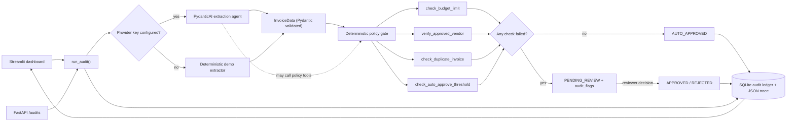
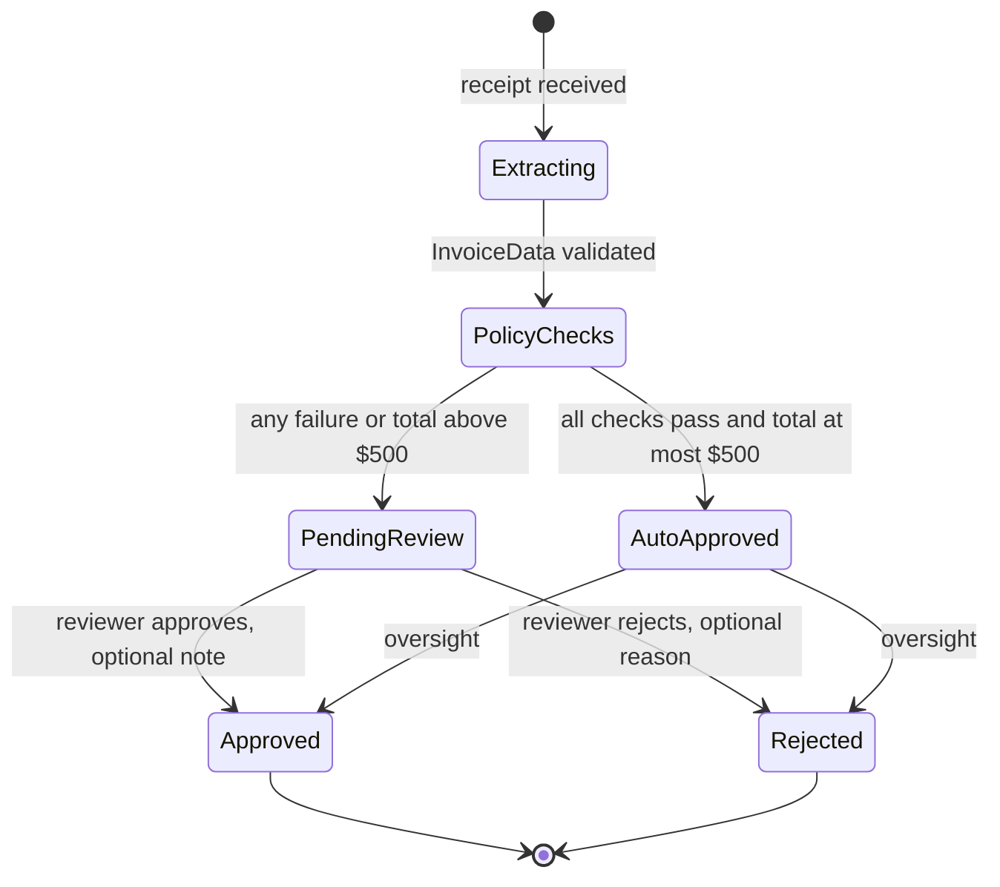

# AuditFlow

Human-in-the-loop expense auditing with PydanticAI, deterministic policy checks,
FastAPI and Streamlit.

[Live site](https://site-b87d91a1f349470bb833ae4b14a0b536.freebuff.page) ·
[Source](https://github.com/dkhedekar79/AuditFlow---agentic-ai-stuff) ·
[MIT License](LICENSE)

AuditFlow reads a receipt, enforces company policy in Python, and pauses for a
human when the numbers need one. The language model extracts typed data. It does
not decide whether an invoice is paid.

The workflow runs without an API key. A deterministic demo extractor parses the
four bundled receipts, the same policy checks run, and the same review queue
appears.

## Website

The live site is a static presentation of the product with an interactive demo
of the four sample receipts:

<https://site-b87d91a1f349470bb833ae4b14a0b536.freebuff.page>

It is plain HTML, CSS and JavaScript served by a small Cloudflare Worker; the
source is in [`site/`](site). The browser demo is illustrative. It does not call
the Python API or write to the ledger, and its decisions reset on reload.

Freebuff Sites hosts static Workers, not Python servers, so the Streamlit
dashboard runs locally. The site says this explicitly rather than pretending the
two are the same application.

## Why this exists

Most agent demos give the model the final decision. That is the wrong shape for
finance. Spend controls need to be reproducible, reviewable and owned by people.

AuditFlow separates three jobs:

| Job | Owner | Reason |
| --- | --- | --- |
| Turn an unstructured receipt into typed data | PydanticAI agent | Language understanding is the model's strength |
| Enforce budgets, vendors and duplicate rules | Python functions | The same input must produce the same policy result |
| Approve or reject spend | Human reviewer | Accountability should not be delegated to a prompt |

The agent produces data, not authority.

## What it does

- Extracts a strict `InvoiceData` model: vendor, date, total, currency, line
  items, category and confidence. Invalid structured output is rejected.
- Runs four policy checks: category budget, approved vendor, duplicate invoice
  and a global auto-approval ceiling.
- Routes clean invoices at or below $500 to `AUTO_APPROVED`. Failed checks,
  duplicates and larger totals become `PENDING_REVIEW` with machine-readable
  flags.
- Pauses at `PENDING_REVIEW` until a reviewer approves or rejects with an
  optional note and reviewer identity.
- Stores every audit, policy payload and human decision in SQLite, with an
  ordered trace that can be inspected or exported.
- Exposes the same `run_audit()` workflow through Streamlit and FastAPI.

## Stack

| Layer | Choice |
| --- | --- |
| Agent | PydanticAI 2.x with typed outputs, dependency injection and function tools |
| Contracts | Pydantic 2 |
| Persistence | SQLite via SQLAlchemy 2, JSON columns and WAL mode |
| API | FastAPI and Uvicorn |
| Dashboard | Streamlit |
| Receipt parsing | pypdf, pdfplumber, JSON and plain text |
| Observability | Stored trace steps, optional JSON-lines sink and Logfire |
| Tests | pytest |

## Demo modes

AuditFlow selects its extraction mode at runtime.

**Demo mode** is the default. With no provider key, the deterministic extractor
parses labelled text and JSON. Policy checks, routing, persistence and review all
run normally. No network calls and no key.

**LLM mode** starts when `OPENAI_API_KEY` or `ANTHROPIC_API_KEY` is present. The
agent extracts the invoice and may call the policy tools while reasoning. After
it returns, AuditFlow re-runs the guardrails deterministically. If the model call
fails, the demo extractor takes over and the trace records an `llm_fallback`
step. Set `AUDITFLOW_STRICT_LLM=1` to fail the audit instead.

The policy gate is identical in both modes.

## Architecture



The model never chooses the route. It proposes a typed invoice; the four checks
run in Python, and their results alone decide whether the audit auto-approves or
pauses.

| Guardrail | Function | Fails when |
| --- | --- | --- |
| Category budget | `check_budget_limit` | The amount exceeds the limit for the extracted category, or the category is unmapped |
| Approved vendor | `verify_approved_vendor` | The vendor is missing from the allow-list or appears on the blocked list |
| Duplicate invoice | `check_duplicate_invoice` | A non-rejected audit with the same normalised vendor, date and amount exists inside the lookback window |
| Approval ceiling | `check_auto_approve_threshold` | The total is above $500, even when the category budget allows it |

Limits, vendor lists, the duplicate window and the ceiling live in
[`data/policies.json`](data/policies.json). Changing policy does not require a
code change.

### Review state machine



`PENDING_REVIEW` is the pause point. The audit, its extraction, policy payloads
and trace are already stored, so a later decision does not re-run the agent.
`APPROVED` and `REJECTED` are terminal; a second decision raises
`InvalidStateTransition` instead of overwriting history. The dashboard queues
pending audits, while the state machine and API also allow oversight of
auto-approved ones.

### Trace contents

Every audit stores an ordered list of `TraceStep` objects.

| Step | Kind | What it records |
| --- | --- | --- |
| `audit_started` | `system` | Source, extraction mode and model |
| `llm_extraction_request` / `structured_output` | `extraction` | Prompt preview, token usage and validated invoice |
| `heuristic_extraction` | `extraction` | Demo-mode parsing result and confidence |
| `policy.check_*` | `tool` | Arguments, payload and latency for each guardrail |
| `guardrail_evaluation` | `policy` | Aggregate pass/fail result |
| `routing_decision` | `routing` | Final status and audit flags |
| `human_decision` | `human` | Reviewer, decision, note and resulting status |

Steps are persisted with the audit, shown in the Trace tab, and optionally
mirrored to a JSON-lines file or Logfire.

## Quickstart

AuditFlow runs offline in demo mode.

```bash
git clone https://github.com/dkhedekar79/AuditFlow---agentic-ai-stuff.git
cd AuditFlow---agentic-ai-stuff

python -m venv .venv
source .venv/bin/activate          # Windows: .venv\Scripts\activate
pip install -r requirements.txt

cp .env.example .env               # optional: add a provider key
streamlit run app/ui.py
```

Open <http://localhost:8501>. The first launch creates `auditflow.db`, which is
ignored by git.

### Using a real model

1. Add `OPENAI_API_KEY=...` or `ANTHROPIC_API_KEY=...` to `.env`.
2. Optionally set `MODEL_NAME`, for example `openai:gpt-4o-mini`.
3. Restart Streamlit. The navigation shows the model name instead of "Demo mode".

## Dashboard walkthrough

The dashboard has three tabs: **Audit**, **Review (n)** and **Trace**. Policy,
ledger counts and the reset control sit in the **Policy, ledger and reset**
expander below the tabs.

1. **Start clean.** Open *Policy, ledger and reset*, tick *Clear the audit
   history*, then select *Reset ledger*. This makes the sample suite repeatable.
2. **Run the samples.** In **Audit**, keep the first sample selected, open *Run
   all four samples* and press *Run sample set*.

   | Receipt | Route | Reason |
   | --- | --- | --- |
   | `01_clean_software_receipt.txt` | `AUTO_APPROVED` | Approved vendor, $89 is inside the software budget and below $500 |
   | `02_over_limit_travel.json` | `PENDING_REVIEW` | $1,249 exceeds the $800 travel budget and the $500 ceiling |
   | `03_duplicate_software_receipt.txt` | `PENDING_REVIEW` | Matches the first invoice's vendor, date and amount |
   | `04_unapproved_vendor_receipt.json` | `PENDING_REVIEW` | QuickCash Gadgets is on the blocked-vendor list |

3. **Review one by hand.** Open **Review**, choose the Contoso travel invoice,
   read the checks and trace, then approve it with a note such as "CFO
   pre-approved the Q4 summit." The audit moves to `APPROVED` and a
   `human_decision` step is appended.
4. **Inspect the evidence.** Open **Trace**, select an audit and use the
   *Timeline*, *Policy*, *Invoice* and *Record* tabs. *Download audit JSON*
   exports a portable record.
5. **Repeat.** Reset the ledger and try another sample, or upload a text, JSON or
   text-based PDF receipt. Scanned images need OCR first.

The duplicate sample is only detected after the clean invoice exists. Run the
suite in order, or run the clean sample before the duplicate.

## HTTP API

```bash
uvicorn app.api:app --reload --port 8000
# interactive docs: http://127.0.0.1:8000/docs
```

| Method | Path | Purpose |
| --- | --- | --- |
| `GET` | `/health` | Liveness and active extraction mode |
| `GET` | `/runtime` | Mode, model and safety flags |
| `POST` | `/audits` | Extract, check, route and persist an audit |
| `GET` | `/audits` | List audits (`?status=PENDING_REVIEW&limit=50&offset=0`) |
| `GET` | `/audits/stats` | Counts by lifecycle status |
| `GET` | `/audits/{id}` | Fetch one audit with its trace |
| `POST` | `/audits/{id}/decision` | Record a human decision |

```bash
# Audit a receipt in demo mode
curl -s -X POST http://127.0.0.1:8000/audits \
  -H 'Content-Type: application/json' \
  --data @- <<'JSON' | python -m json.tool
{"text": "Vendor: Northwind Cloud Services\nDate: 2026-10-14\nTotal: 89.00", "source": "curl-clean.txt"}
JSON

# Resume a paused audit
curl -s -X POST http://127.0.0.1:8000/audits/1/decision \
  -H 'Content-Type: application/json' \
  -d '{"decision": "APPROVED", "note": "Manager approved.", "reviewer": "daiwik"}'
```

Errors are explicit: `422` for unreadable receipts or invalid payloads, `404` for
unknown audits, and `409` when a terminal audit is decided twice.

## Configuration

Copy [`.env.example`](.env.example) to `.env`. Real environment variables win
over the file.

| Variable | Default | Purpose |
| --- | --- | --- |
| `OPENAI_API_KEY` | empty | Enables OpenAI extraction |
| `ANTHROPIC_API_KEY` | empty | Enables Anthropic extraction |
| `MODEL_NAME` | inferred | PydanticAI model string, e.g. `openai:gpt-4o-mini` |
| `AUDITFLOW_DEMO_MODE` | `0` | Force the deterministic extractor even with a key |
| `AUDITFLOW_STRICT_LLM` | `0` | Fail instead of falling back when an LLM call fails |
| `AUDITFLOW_DB_PATH` | `auditflow.db` | SQLite ledger path |
| `AUDITFLOW_TRACE_LOG` | empty | JSON-lines sink for trace steps |
| `LOGFIRE_TOKEN` | empty | Stream PydanticAI spans to Logfire |

### Policy

[`data/policies.json`](data/policies.json) defines:

- category budgets for software, travel, meals, office supplies, hardware,
  professional services, training and an `other` fallback; unknown categories
  fail closed;
- the $500 auto-approval ceiling;
- approved vendors with aliases, risk level and payment terms;
- blocked vendors with a reason shown to the reviewer;
- the duplicate lookback window and amount tolerance.

The loader caches by file modification time, so edits are picked up without a
restart.

Budgets are enforced in the policy base currency (`USD`). AuditFlow records the
receipt currency but does not convert it, so a EUR receipt is compared
numerically against USD limits. Multi-currency support is production hardening,
not a solved feature.

## Project structure

```text
.
├── app/
│   ├── __init__.py
│   ├── models.py          # InvoiceData, PolicyResult, TraceStep, AuditRecord, ReviewDecision
│   ├── database.py        # schema, CRUD, duplicate lookup, state machine
│   ├── tools.py           # budget, vendor and duplicate guardrails
│   ├── parsing.py         # PDF, JSON and text ingestion
│   ├── agent.py           # PydanticAI agent, demo extractor, routing and trace
│   ├── api.py             # FastAPI surface
│   └── ui.py              # Streamlit dashboard
├── data/
│   ├── policies.json
│   └── sample_receipts/
│       ├── 01_clean_software_receipt.txt
│       ├── 02_over_limit_travel.json
│       ├── 03_duplicate_software_receipt.txt
│       └── 04_unapproved_vendor_receipt.json
├── site/
│   ├── public/            # index.html, styles.css, app.js, favicon
│   ├── worker.js          # static asset handler and /health
│   ├── wrangler.toml      # local workerd configuration
│   └── deploy.json        # hosting manifest
├── tests/
│   ├── test_agent_evals.py
│   └── test_api.py
├── .env.example
├── .streamlit/config.toml
├── pytest.ini
├── requirements.txt
├── LICENSE
└── README.md
```

## Tests

```bash
pytest -q
```

The suite runs offline, forces demo mode and uses a temporary SQLite file per
test. The core evaluation is parameterised over the four receipts and asserts
both status and audit flags, so a regression in extraction, policy or routing
fails.

Coverage includes:

- the four routing outcomes and their exact flags;
- typed extraction for every sample and malformed-input errors;
- budget, vendor and duplicate guardrails;
- approval and rejection notes, trace append and illegal second decisions;
- rejected invoices not blocking a legitimate resubmission;
- trace serialisation and the JSON-lines sink;
- FastAPI create, list, stats and decision endpoints.

The static site can be checked locally with Wrangler:

```bash
npx wrangler dev --config site/wrangler.toml --port 8788
# http://127.0.0.1:8788
```

## Design notes

**The model proposes; Python disposes.** The LLM turns a receipt into a typed
invoice. It may call policy tools for context, but its opinion does not decide
the route. The deterministic gate runs again and is the only input to routing.

**A trace is data, not a log line.** Each step is a validated `TraceStep` stored
with the audit. The timeline, the JSON export and the JSON-lines sink are views
over the same facts.

**Human decisions are append-only.** Transitions are validated centrally. Once an
audit is approved or rejected, a second decision raises
`InvalidStateTransition` rather than overwriting the reviewer and rationale.

**Guardrails run twice for LLM audits.** Agent calls are tagged `agent.*` and
deterministic gate calls are tagged `policy.*`, so a reviewer can tell them apart.

**Prompt injection is contained, not eliminated.** Receipt text is wrapped
between markers and the prompt treats it as data. More importantly, the model
cannot approve anything: output must validate as `InvoiceData`, and a human sees
anything suspicious. Do not expose this demo API to untrusted users without
authentication and rate limiting.

**SQLite is deliberate.** A single file with WAL mode keeps clone-and-run instant
and duplicate detection easy to test. The storage boundary is isolated in
`app/database.py`; Postgres with migrations is the next step for multi-user use.

## Limitations

- PDF extraction needs a text layer. Scanned images are rejected rather than
  silently misread; OCR and vision extraction are not included.
- No FX conversion.
- The API has no authentication, tenancy or rate limiting.
- The approval ceiling is global, not per department or cost centre.
- Line items are extracted and displayed, but policy checks use invoice totals.
- Duplicate detection matches normalised vendor, date and amount; it does not use
  fuzzy invoice numbers or embedding similarity.
- SQLite serialises writes, which suits a single reviewer and a demo, not a large
  finance team.

## License

AuditFlow is a reference project, not financial advice or a certified controls
system. Review the policy engine and add authentication before pointing it at
real spend.

Released under the [MIT License](LICENSE) © 2026 Daiwik Khedekar.
