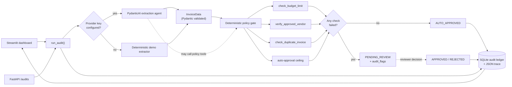

<div align="center">

# 🧾 AuditFlow

### Human-in-the-loop expense & invoice auditor

**PydanticAI extracts. Deterministic policy tools decide. A human signs off.**

[](https://www.python.org/)
[](https://ai.pydantic.dev/)
[](https://fastapi.tiangolo.com/)
[](https://streamlit.io/)
[](LICENSE)

</div>

AuditFlow is a portfolio-grade reference implementation of an **agentic workflow
that is allowed to pause**. An LLM reads a messy receipt, deterministic Python
tools enforce company policy, and anything unusual stops in a review queue until
a human approves or rejects it — with every tool call, policy check and decision
captured in an inspectable reasoning trace.

It runs **without an API key** thanks to a deterministic demo extractor, so you
can clone the repo and exercise the complete workflow in under a minute.

---

## Why this exists

Most agent demos hand the final decision to the model. That is the wrong
abstraction for finance: spend controls need to be reproducible, auditable and
owned by people.

AuditFlow separates the three jobs:

| Job | Owner | Why |
| --- | --- | --- |
| Turn an unstructured receipt into typed data | LLM (PydanticAI) | Language understanding is the model's strength |
| Enforce budgets, vendor rules and duplicate checks | Deterministic Python | Same input must always produce the same policy result |
| Approve money movement | Human reviewer | Accountability cannot be delegated to a prompt |

The result is an agent whose **output is data, not authority**.

## What it does

- **Typed extraction** — receipts become a strict `InvoiceData` model
  (`vendor`, `date`, `total_amount`, `currency`, `line_items`, `category`,
  `confidence_score`); malformed model output is rejected by Pydantic and retried.
- **Three deterministic guardrails** — category budget limits, an approved-vendor
  allow-list (with blocked suppliers) and duplicate-invoice detection against the
  SQLite ledger.
- **Routing with a real state machine** — clean invoices at or below **$500** are
  `AUTO_APPROVED`; failed checks, duplicates or larger totals become
  `PENDING_REVIEW` with explicit audit flags.
- **Human-in-the-loop pause/resume** — reviewers approve (with an optional
  override note) or reject from the dashboard; the decision is written to the
  ledger and appended to the audit trace. Terminal states cannot be re-decided.
- **Complete observability** — every LLM request, tool call, policy result and
  routing decision is stored as a `TraceStep`, streamed to an optional JSON-lines
  sink, and rendered in a trace inspector.
- **Three ways in** — a Streamlit dashboard, a FastAPI surface, and a pytest
  evaluation suite that asserts the routing of all four demo receipts.

## Stack

| Layer | Choice |
| --- | --- |
| Agent framework | [PydanticAI](https://ai.pydantic.dev/) 2.x — typed outputs, dependency injection, function tools |
| Contracts | Pydantic 2 |
| Persistence | SQLite via SQLAlchemy 2 (JSON columns + WAL mode) |
| Backend | FastAPI + Uvicorn |
| Dashboard | Streamlit |
| Document parsing | pypdf + pdfplumber, plus JSON and plain text |
| Observability | Local JSON trace steps, optional Logfire/OpenTelemetry |
| Evaluation | pytest |

## Demo modes

AuditFlow selects its extraction mode at runtime:

- **LLM mode** — set `OPENAI_API_KEY` (or `ANTHROPIC_API_KEY`) in `.env`. The
  agent extracts fields and may call the policy tools while doing so.
- **Demo mode** — leave the keys blank. A deterministic extractor parses the
  bundled receipts, policies still run, and the same review queue appears. No
  network calls, no key, no cost.

The deterministic policy gate runs in **both** modes, so routing is identical.

---

## Architecture



The LLM never decides the route. It proposes a typed `InvoiceData`; the same four
checks then run in Python, and their results alone decide whether the workflow
auto-approves or pauses.

| Guardrail | Function | Fails when |
| --- | --- | --- |
| Category budget | `check_budget_limit` | The amount exceeds the limit for the extracted category, or the category is unmapped |
| Approved vendor | `verify_approved_vendor` | The vendor is missing from the allow-list, or appears on the blocked list |
| Duplicate invoice | `check_duplicate_invoice` | A non-rejected audit with the same normalised vendor, invoice date and amount exists inside the lookback window |
| Auto-approval ceiling | `check_auto_approve_threshold` | The total is above **$500**, even when the category budget allows it |

All limits, the vendor allow-list, the duplicate window and the ceiling live in
[`data/policies.json`](data/policies.json). Editing policy never requires a code
change.

### Human-in-the-loop state machine


`PENDING_REVIEW` is the pause point: the audit has already been written to the
ledger with its extraction, policy results and full trace, so a reviewer (or a
later process) can resume it without re-running the agent. `APPROVED` and
`REJECTED` are terminal; [`app/database.py`](app/database.py) rejects any second
decision with `InvalidStateTransition` instead of silently overwriting history.

### What a trace contains

Every audit stores an ordered list of `TraceStep` objects. A flagged audit
typically contains:

| Step | Kind | What it proves |
| --- | --- | --- |
| `audit_started` | `system` | Source, extraction mode and model used |
| `llm_extraction_request` / `structured_output` | `extraction` | The model prompt preview, token usage and validated invoice |
| `heuristic_extraction` | `extraction` | Demo-mode parsing result and confidence |
| `policy.check_*` | `tool` | Exact arguments, payloads and latency of each guardrail |
| `guardrail_evaluation` | `policy` | Aggregate pass/fail result |
| `routing_decision` | `routing` | Final status and machine-readable audit flags |
| `human_decision` | `human` | Reviewer, decision, note and resulting status |

These steps are persisted with the audit, rendered in the Trace Inspector and
optionally mirrored to a JSON-lines file or Logfire.

---

## Quickstart

AuditFlow runs fully offline in demo mode. You do **not** need an API key to try
the complete workflow.

```bash
git clone https://github.com/dkhedekar79/AuditFlow---agentic-ai-stuff.git
cd AuditFlow---agentic-ai-stuff

python -m venv .venv
source .venv/bin/activate          # Windows: .venv\Scripts\activate
pip install -r requirements.txt

cp .env.example .env               # optional: add a provider key
streamlit run app/ui.py
```

Open <http://localhost:8501>. The first launch creates `auditflow.db` (SQLite,
ignored by git) with an empty audit ledger.

### Switching on a real LLM

1. Add `OPENAI_API_KEY=sk-...` or `ANTHROPIC_API_KEY=...` to `.env`.
2. Set `MODEL_NAME` if you want a model other than the provider default
   (`openai:gpt-4o-mini` / `anthropic:claude-3-5-sonnet-latest`).
3. Restart Streamlit. The sidebar badge changes from **Demo mode** to **LLM mode**.

The agent receives the three policy tools and may call them while extracting.
After it returns, AuditFlow re-runs every check deterministically. If the model
call fails (bad key, rate limit, invalid structured output), the deterministic
extractor takes over and the trace records an `llm_fallback` step. Set
`AUDITFLOW_STRICT_LLM=1` to fail the audit instead of falling back.

---

## Demo walkthrough

1. **Start clean.** The sidebar shows policy version, category budgets and ledger
   counts. *Reset demo ledger* clears history so the sample suite is repeatable.
2. **Run the suite.** Open **Upload / Test Sample** → *Run the four-receipt
   evaluation in order*. The table shows each receipt's route and flags:

   | Receipt | Expected route | Why |
   | --- | --- | --- |
   | `01_clean_software_receipt.txt` | `AUTO_APPROVED` | Approved vendor, $89 is inside the software budget and below $500 |
   | `02_over_limit_travel.json` | `PENDING_REVIEW` | $1,249 exceeds the $800 travel budget and the $500 ceiling |
   | `03_duplicate_software_receipt.txt` | `PENDING_REVIEW` | Matches the first invoice's vendor, date and amount |
   | `04_unapproved_vendor_receipt.json` | `PENDING_REVIEW` | QuickCash Gadgets is on the blocked-vendor list |

3. **Review one by hand.** Open **Human Review Queue**, select the Contoso travel
   invoice, expand the policy checks and trace, then approve it with a note such
   as *"CFO pre-approved the Q4 summit."* The audit moves to `APPROVED` and a
   `human_decision` step is appended.
4. **Inspect the evidence.** Open **Audit Trace Inspector**, pick any audit and
   compare the extracted JSON, policy payloads and trace timeline. Use
   *Download audit JSON* for a portable record.
5. **Replay.** Reset the ledger and repeat with a different sample, or upload your
   own text/JSON/PDF receipt (text-based PDFs; scanned images need OCR first).

> The duplicate sample is only detectable **after** the clean invoice exists. Run
> the suite in order, or run the clean sample before the duplicate sample.
