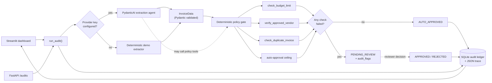
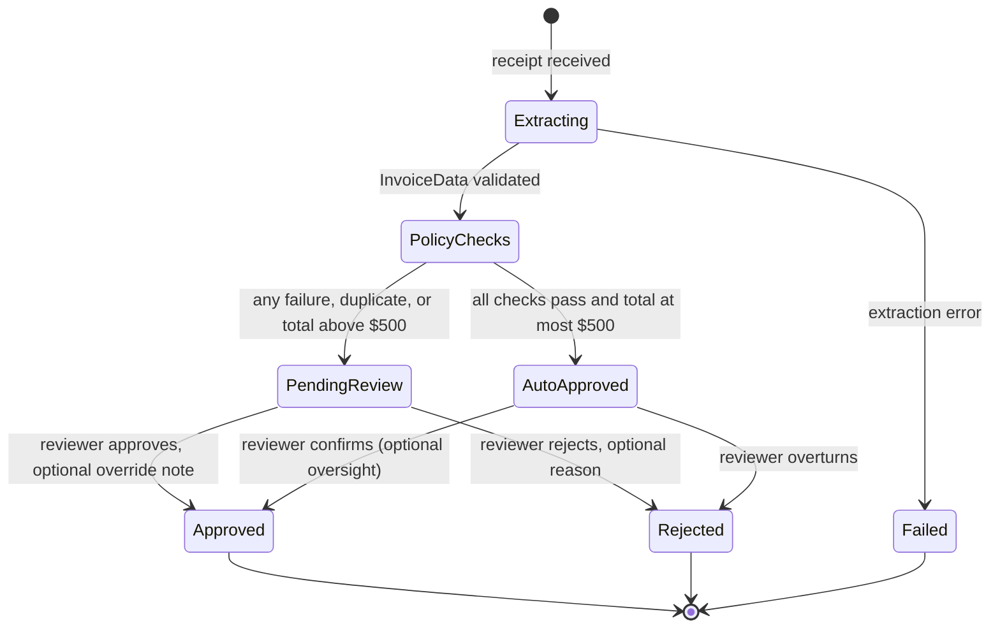

<div align="center">

# 🧾 AuditFlow

### Human-in-the-loop expense & invoice auditor

**PydanticAI extracts. Deterministic policy tools decide. A human signs off.**

[](https://www.python.org/)
[](https://ai.pydantic.dev/)
[](https://fastapi.tiangolo.com/)
[](https://streamlit.io/)
[](LICENSE)

</div>

AuditFlow is a portfolio-grade reference implementation of an **agentic workflow
that is allowed to pause**. An LLM reads a messy receipt, deterministic Python
tools enforce company policy, and anything unusual stops in a review queue until
a human approves or rejects it — with every tool call, policy check and decision
captured in an inspectable reasoning trace.

It runs **without an API key** thanks to a deterministic demo extractor, so you
can clone the repo and exercise the complete workflow in under a minute.

---

## Why this exists

Most agent demos hand the final decision to the model. That is the wrong
abstraction for finance: spend controls need to be reproducible, auditable and
owned by people.

AuditFlow separates the three jobs:

| Job | Owner | Why |
| --- | --- | --- |
| Turn an unstructured receipt into typed data | LLM (PydanticAI) | Language understanding is the model's strength |
| Enforce budgets, vendor rules and duplicate checks | Deterministic Python | Same input must always produce the same policy result |
| Approve money movement | Human reviewer | Accountability cannot be delegated to a prompt |

The result is an agent whose **output is data, not authority**.

## What it does

- **Typed extraction** — receipts become a strict `InvoiceData` model
  (`vendor`, `date`, `total_amount`, `currency`, `line_items`, `category`,
  `confidence_score`); malformed model output is rejected by Pydantic and retried.
- **Deterministic guardrails** — category budget limits, an approved-vendor
  allow-list (with blocked suppliers), duplicate-invoice detection against the
  SQLite ledger, and a hard auto-approval ceiling.
- **Routing with a real state machine** — clean invoices at or below **$500** are
  `AUTO_APPROVED`; failed checks, duplicates or larger totals become
  `PENDING_REVIEW` with explicit audit flags.
- **Human-in-the-loop pause/resume** — reviewers approve (with an optional
  override note) or reject from the dashboard; the decision is written to the
  ledger and appended to the audit trace. Terminal states cannot be re-decided.
- **Complete observability** — every LLM request, tool call, policy result and
  routing decision is stored as a `TraceStep`, streamed to an optional JSON-lines
  sink, and rendered in a trace inspector.
- **Three ways in** — a Streamlit dashboard, a FastAPI surface, and a pytest
  evaluation suite that asserts the routing of all four demo receipts.

## Stack

| Layer | Choice |
| --- | --- |
| Agent framework | [PydanticAI](https://ai.pydantic.dev/) 2.x — typed outputs, dependency injection, function tools |
| Contracts | Pydantic 2 |
| Persistence | SQLite via SQLAlchemy 2 (JSON columns + WAL mode) |
| Backend | FastAPI + Uvicorn |
| Dashboard | Streamlit |
| Document parsing | pypdf + pdfplumber, plus JSON and plain text |
| Observability | Local JSON trace steps, optional Logfire/OpenTelemetry |
| Evaluation | pytest |

## Demo modes

AuditFlow selects its extraction mode at runtime:

- **LLM mode** — set `OPENAI_API_KEY` (or `ANTHROPIC_API_KEY`) in `.env`. The
  agent extracts fields and may call the policy tools while doing so.
- **Demo mode** — leave the keys blank. A deterministic extractor parses the
  bundled receipts, policies still run, and the same review queue appears. No
  network calls, no key, no cost.

The deterministic policy gate runs in **both** modes, so routing is identical.

---

## Architecture



The LLM never decides the route. It proposes a typed `InvoiceData`; the same four
checks then run in Python, and their results alone decide whether the workflow
auto-approves or pauses.

| Guardrail | Function | Fails when |
| --- | --- | --- |
| Category budget | `check_budget_limit` | The amount exceeds the limit for the extracted category, or the category is unmapped |
| Approved vendor | `verify_approved_vendor` | The vendor is missing from the allow-list, or appears on the blocked list |
| Duplicate invoice | `check_duplicate_invoice` | A non-rejected audit with the same normalised vendor, invoice date and amount exists inside the lookback window |
| Auto-approval ceiling | `check_auto_approve_threshold` | The total is above **$500**, even when the category budget allows it |

All limits, the vendor allow-list, the duplicate window and the ceiling live in
[`data/policies.json`](data/policies.json). Editing policy never requires a code
change.

### Human-in-the-loop state machine



`PENDING_REVIEW` is the pause point: the audit has already been written to the
ledger with its extraction, policy results and full trace, so a reviewer (or a
later process) can resume it without re-running the agent. `APPROVED` and
`REJECTED` are terminal; [`app/database.py`](app/database.py) rejects any second
decision with `InvalidStateTransition` instead of silently overwriting history.

### What a trace contains

Every audit stores an ordered list of `TraceStep` objects. A flagged audit
typically contains:

| Step | Kind | What it proves |
| --- | --- | --- |
| `audit_started` | `system` | Source, extraction mode and model used |
| `llm_extraction_request` / `structured_output` | `extraction` | The model prompt preview, token usage and validated invoice |
| `heuristic_extraction` | `extraction` | Demo-mode parsing result and confidence |
| `policy.check_*` | `tool` | Exact arguments, payloads and latency of each guardrail |
| `guardrail_evaluation` | `policy` | Aggregate pass/fail result |
| `routing_decision` | `routing` | Final status and machine-readable audit flags |
| `human_decision` | `human` | Reviewer, decision, note and resulting status |

These steps are persisted with the audit, rendered in the Trace Inspector and
optionally mirrored to a JSON-lines file or Logfire.

---

## Quickstart

AuditFlow runs fully offline in demo mode. You do **not** need an API key to try
the complete workflow.

```bash
git clone https://github.com/dkhedekar79/AuditFlow---agentic-ai-stuff.git
cd AuditFlow---agentic-ai-stuff

python -m venv .venv
source .venv/bin/activate          # Windows: .venv\Scripts\activate
pip install -r requirements.txt

cp .env.example .env               # optional: add a provider key
streamlit run app/ui.py
```

Open <http://localhost:8501>. The first launch creates `auditflow.db` (SQLite,
ignored by git) with an empty audit ledger.

### Switching on a real LLM

1. Add `OPENAI_API_KEY=sk-...` or `ANTHROPIC_API_KEY=...` to `.env`.
2. Set `MODEL_NAME` if you want a model other than the provider default
   (`openai:gpt-4o-mini` / `anthropic:claude-3-5-sonnet-latest`).
3. Restart Streamlit. The sidebar badge changes from **Demo mode** to **LLM mode**.

The agent receives the three policy tools and may call them while extracting.
After it returns, AuditFlow re-runs every check deterministically. If the model
call fails (bad key, rate limit, invalid structured output), the deterministic
extractor takes over and the trace records an `llm_fallback` step. Set
`AUDITFLOW_STRICT_LLM=1` to fail the audit instead of falling back.

---

## Demo walkthrough

1. **Start clean.** The sidebar shows policy version, category budgets and ledger
   counts. *Reset demo ledger* clears history so the sample suite is repeatable.
2. **Run the suite.** Open **Upload / Test Sample** → *Run the four-receipt
   evaluation in order*. The table shows each receipt's route and flags:

   | Receipt | Expected route | Why |
   | --- | --- | --- |
   | `01_clean_software_receipt.txt` | `AUTO_APPROVED` | Approved vendor, $89 is inside the software budget and below $500 |
   | `02_over_limit_travel.json` | `PENDING_REVIEW` | $1,249 exceeds the $800 travel budget and the $500 ceiling |
   | `03_duplicate_software_receipt.txt` | `PENDING_REVIEW` | Matches the first invoice's vendor, date and amount |
   | `04_unapproved_vendor_receipt.json` | `PENDING_REVIEW` | QuickCash Gadgets is on the blocked-vendor list |

3. **Review one by hand.** Open **Human Review Queue**, select the Contoso travel
   invoice, expand the policy checks and trace, then approve it with a note such
   as *"CFO pre-approved the Q4 summit."* The audit moves to `APPROVED` and a
   `human_decision` step is appended.
4. **Inspect the evidence.** Open **Audit Trace Inspector**, pick any audit and
   compare the extracted JSON, policy payloads and trace timeline. Use
   *Download audit JSON* for a portable record.
5. **Replay.** Reset the ledger and repeat with a different sample, or upload your
   own text/JSON/PDF receipt (text-based PDFs; scanned images need OCR first).

> The duplicate sample is only detectable **after** the clean invoice exists. Run
> the suite in order, or run the clean sample before the duplicate sample.

---

## HTTP API

The dashboard is the primary interface, but the workflow is also a small JSON
API. Start it with:

```bash
uvicorn app.api:app --reload --port 8000
# interactive docs: http://127.0.0.1:8000/docs
```

| Method | Path | Purpose |
| --- | --- | --- |
| `GET` | `/health` | Liveness plus the active extraction mode |
| `GET` | `/runtime` | Mode, model and safety flags |
| `POST` | `/audits` | Run extraction, guardrails and routing; persist the audit |
| `GET` | `/audits` | List audits (`?status=PENDING_REVIEW&limit=50&offset=0`) |
| `GET` | `/audits/stats` | Counts for every lifecycle status |
| `GET` | `/audits/{id}` | Fetch one audit with its full trace |
| `POST` | `/audits/{id}/decision` | Record a human approve/reject decision |

```bash
# Audit a receipt (demo mode if no key is configured)
curl -s -X POST http://127.0.0.1:8000/audits \
  -H 'Content-Type: application/json' \
  --data @- <<'JSON' | python -m json.tool
{"text": "Vendor: Northwind Cloud Services\nDate: 2026-10-14\nTotal: 89.00", "source": "curl-clean.txt"}
JSON

# Resume a paused audit with a human decision
curl -s -X POST http://127.0.0.1:8000/audits/1/decision \
  -H 'Content-Type: application/json' \
  -d '{"decision": "APPROVED", "note": "Manager approved.", "reviewer": "daiwik"}'
```

Errors are explicit: `422` for unreadable receipts or invalid payloads, `404`
for unknown audits, and `409` when a terminal audit is decided twice.

---

## Configuration

Copy [`.env.example`](.env.example) to `.env`. Real environment variables always
win over the file.

| Variable | Default | Purpose |
| --- | --- | --- |
| `OPENAI_API_KEY` | empty | Enables OpenAI extraction when set |
| `ANTHROPIC_API_KEY` | empty | Enables Anthropic extraction when set |
| `MODEL_NAME` | inferred | PydanticAI model string, e.g. `openai:gpt-4o-mini` |
| `AUDITFLOW_DEMO_MODE` | `0` | Force the deterministic extractor even with a key present |
| `AUDITFLOW_STRICT_LLM` | `0` | Fail instead of falling back when an LLM call fails |
| `AUDITFLOW_DB_PATH` | `auditflow.db` | SQLite file for the audit ledger |
| `AUDITFLOW_TRACE_LOG` | empty | Optional JSON-lines sink for every trace step |
| `LOGFIRE_TOKEN` | empty | Stream PydanticAI spans to Logfire |

### Policy

[`data/policies.json`](data/policies.json) is the source of truth for:

- **Category budgets** — software, travel, meals, office supplies, hardware,
  professional services, training and an `other` fallback. Unknown categories
  fail closed instead of guessing a limit.
- **Auto-approval ceiling** — currently `$500`; any total above it pauses for a
  human even if the category budget is fine.
- **Approved vendors** — names plus aliases, risk level and payment terms.
- **Blocked vendors** — explicit denial with the reason shown in the review queue.
- **Duplicate window** — lookback days and amount tolerance used by duplicate
  detection.

The policy loader caches by file modification time, so editing the JSON is picked
up without a code change or restart.

> Budgets are enforced in the policy's base currency (`USD`). AuditFlow records
> the receipt currency but does **not** perform FX conversion, so a EUR receipt is
> compared numerically against USD limits. Treat multi-currency support as a
> production hardening task rather than a solved feature.

---

## Project structure

```text
.
├── app/
│   ├── __init__.py
│   ├── models.py          # InvoiceData, PolicyResult, TraceStep, AuditRecord, ReviewDecision
│   ├── database.py        # SQLite schema, CRUD, duplicate lookup, state machine
│   ├── tools.py           # budget, vendor and duplicate guardrails + policies.json loader
│   ├── parsing.py         # PDF (pypdf/pdfplumber), JSON and text ingestion
│   ├── agent.py           # PydanticAI agent, demo extractor, routing and trace collector
│   ├── api.py             # FastAPI surface
│   └── ui.py              # Streamlit dashboard (upload, review queue, trace inspector)
├── data/
│   ├── policies.json
│   └── sample_receipts/
│       ├── 01_clean_software_receipt.txt
│       ├── 02_over_limit_travel.json
│       ├── 03_duplicate_software_receipt.txt
│       └── 04_unapproved_vendor_receipt.json
├── tests/
│   ├── test_agent_evals.py  # routing evals, guardrails, HITL state machine, traces
│   └── test_api.py          # FastAPI contract tests
├── .env.example
├── .streamlit/config.toml
├── pytest.ini
├── requirements.txt
├── LICENSE
└── README.md
```

---

## Tests and evaluation

```bash
pytest -q
```

Everything runs offline: the suite forces demo mode and uses a temporary SQLite
file per test. The core evaluation is parameterised over the four shipped
receipts and asserts the documented status **and** audit flags, so a regression in
extraction, policy tools or routing fails loudly.

Coverage includes:

- the four routing outcomes and their exact flags;
- typed extraction for every sample, plus malformed-input errors;
- budget, vendor and duplicate guardrails;
- human approval/rejection, notes, trace append and illegal second decisions;
- rejected invoices not blocking a legitimate resubmission;
- trace completeness, JSON serialisation and the JSON-lines sink;
- FastAPI create/list/stats/decision endpoints and their error codes.

---

## Design notes

**The model proposes; Python disposes.** The LLM is excellent at turning a PDF
into a typed invoice and poor at being an authority on company policy. AuditFlow
lets it call the policy tools for context, then ignores its opinion and re-runs
the guardrails deterministically. The same checks run in demo mode, which is why
routing is reproducible in tests.

**A trace is data, not a log line.** Each step is a validated `TraceStep` stored
with the audit, not a string in a rotating file. That makes the UI's timeline, the
downloadable audit export and the JSON-lines sink views over the same facts.

**Human decisions are append-only.** Status transitions are validated centrally.
Once an audit is approved or rejected, a second decision raises
`InvalidStateTransition` rather than overwriting the reviewer's name and rationale.

**Guardrails are enforced twice for LLM runs.** The agent may call
`check_budget_limit`, `verify_approved_vendor` and `check_duplicate_invoice` while
it reasons; the authoritative gate then calls the same functions again. Tool calls
made by the model are tagged `agent.*` in the trace, deterministic gate calls are
tagged `policy.*`, so a reviewer can tell them apart.

**Prompt injection is contained, not eliminated.** Receipt text is wrapped between
explicit markers and the prompt tells the model to treat it as data. More
importantly, the model cannot approve anything: its output must validate as
`InvoiceData`, and the human gate catches suspicious extractions. Do not expose
this demo API to untrusted users without authentication and rate limiting.

**SQLite is deliberate.** A single-file ledger with WAL mode keeps the clone-and-run
experience instant and makes duplicate detection trivial to test. The storage
boundary is isolated in `app/database.py`; Postgres plus migrations is the natural
next step for multi-user deployment.

---

## Limitations and roadmap

Known limitations of this reference implementation:

- PDF extraction needs a text layer; scanned images are rejected with a clear
  message instead of being silently misread. OCR/vision extraction is not included.
- No FX conversion; budgets are enforced in the policy base currency.
- The API has no authentication, tenancy or rate limiting — it is a local demo
  surface, not a production finance service.
- The approval ceiling is global, not per department, cost centre or employee.
- Line items are extracted and shown, but policy checks operate on invoice totals.
- Duplicate detection matches normalised vendor + invoice date + amount; it does not
  use fuzzy invoice numbers or embedding similarity.
- SQLite serialises writes, which is ideal for one reviewer and a demo, not a large
  finance team.

Planned next steps:

- OCR/vision fallback for scanned receipts and multi-page statements.
- Department-level budgets and approval chains.
- Postgres + Alembic, then SSO and role-based reviewer permissions.
- Notification hooks (Slack/email) for audits approaching their review SLA.
- Per-run LLM usage limits and cost dashboards in the trace inspector.
- More adversarial fixtures: prompt-injection receipts, foreign currencies,
  negative lines, tax-only invoices.

---

## Safety and license

AuditFlow is a portfolio/reference project, not financial advice or a certified
controls system. Review the policy engine and add authentication before pointing it
at real spend.

Released under the [MIT License](LICENSE) © 2026 Daiwik Khedekar.
